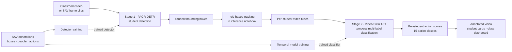

<div align="center">

# ClassSight

### Spatiotemporal Student Behavior Recognition in Classrooms

**A two-stage computer vision framework for detecting students and recognizing multi-label behavior in classroom video.**

[](https://www.python.org/)
[](https://pytorch.org/)
[](#architecture)
[](https://jupyter.org/)
[](https://www.gradio.app/)
[](#what-is-included)

**[Explore the repository](https://github.com/DivyaMaki/classroom-student-behavior-recognition)**

</div>

## Contents

- [Overview](#overview)
- [Architecture](#architecture)
- [What is included](#what-is-included)
- [ClassSight demo](#classsight-interactive-demo)
- [Getting started](#getting-started)
- [Training](#training)
- [Inference](#inference)
- [Reproducibility, privacy, and responsible use](#reproducibility-privacy-and-responsible-use)
- [License](#license)

## Overview

ClassSight brings together spatial student detection and temporal action recognition to analyze classroom video at the individual-student level. The research framework combines **PACR-DETR** with a **Video Swin-based Temporal Segment Transformer (TST)**, producing multi-label behavior predictions rather than forcing each student into a single action category.

The project team reports using the **Student Action Video (SAV)** dataset with permission. The paper describes SAV as 4,324 three-second clips from 758 classrooms, annotated with student bounding boxes and 15 multi-label actions.

## Architecture

The detector supplies student locations; an IoU-based tracker in the inference notebook associates detections between frames; per-student video tubes are then classified by TST.



### Stage 1 — PACR-DETR student detection

The spatial branch uses a Position-Aware Channel Residual (PACR) attention module with a detection-transformer pipeline and multi-scale feature fusion to localize students, including in crowded scenes.

### Stage 2 — Video Swin TST behavior recognition

The temporal branch classifies student video tubes with 3D shifted-window attention. The training configuration uses **3 temporal segments × 16 frames** and predicts 15 action labels per student. Asymmetric loss and a cosine classifier address the long-tailed, multi-label action distribution.

<details>
<summary><strong>Action labels used by the TST implementation</strong></summary>

`sit` · `stand` · `look_forward` · `look_sideways` · `read` · `flip_books` · `touch_sth` · `raise_hand` · `hands_down` · `take_notes` · `applaud` · `bend` · `turn_around` · `talk_with_others` · `answer_questions`

</details>

## What is included

| Path | Purpose |
|:--|:--|
| [`Code/pacr-bounding.ipynb`](Code/pacr-bounding.ipynb) | PACR-DETR person-detection training workflow for SAV bounding boxes. |
| [`Code/TST code.py`](Code/TST%20code.py) | Video Swin/TST model, SAV data loader, training loop, and evaluation. |
| [`Code/inference.ipynb`](Code/inference.ipynb) | Combined detection/classification inference and Gradio interface. |
| [`models/pacr_best.pth`](models/pacr_best.pth) | PACR-DETR detection checkpoint. |
| [`models/tst_best.pth`](models/tst_best.pth) | TST behavior-classification checkpoint. |

Checkpoints are stored using **Git LFS**. The SAV data and the paper PDF are not included. The inference notebook also references a `pacr_detr` implementation that must be made available separately.

## ClassSight interactive demo

The Gradio interface is implemented in `Code/inference.ipynb` (the notebook currently titles the app **“Classroom Behavior Recognition”**). Its tabs provide:

- **Analyze Video** — upload classroom video and view annotated output, a keyframe, a class-engagement dashboard, student cards, and a summary.
- **Detect Students** — upload a frame and view detected student boxes.
- **SAV Demos** — run the interface against a configured sample clip.

<div align="center">

| Video analysis | Student detection | SAV demo |
|:--:|:--:|:--:|
| *Screenshot placeholder*<br>_Add a demo screenshot here_ | *Screenshot placeholder*<br>_Add a detection screenshot here_ | *Screenshot placeholder*<br>_Add a demo screenshot here_ |

</div>

> Screenshots are placeholders only; no demo screenshots are currently included in the repository. The notebook launches Gradio with sharing enabled. Do not expose classroom recordings or student information through a public demo link.

## Getting started

### 1. Clone the repository and fetch model weights

Install [Git LFS](https://git-lfs.com/) before cloning. The two checkpoints total approximately **1.3 GB**.

```bash
git lfs install
git clone https://github.com/DivyaMaki/classroom-student-behavior-recognition.git
cd classroom-student-behavior-recognition
```

### 2. Install dependencies

Install a **PyTorch/torchvision** build appropriate for your Python version and CPU/CUDA environment using the [official PyTorch instructions](https://pytorch.org/get-started/locally/). Then install the other packages:

```bash
python -m pip install numpy pandas pillow scipy einops tqdm opencv-python matplotlib jupyter gradio nest_asyncio
```

Open the notebooks with Jupyter or configure a Kaggle notebook environment. A CUDA-capable GPU is recommended for TST training and video inference.

## Training

### PACR-DETR

Open `Code/pacr-bounding.ipynb`, set the SAV frame/annotation paths and output directory in its configuration, then run the notebook cells to train or evaluate student detection.

### Video Swin TST

Set `DATA_ROOT`, `FRAMES_DIR`, `TRAIN_CSV`, `VAL_CSV`, and the checkpoint/pretrained-weight paths in `Config` in `Code/TST code.py`. The script's `train(config)` call in its `__main__` block is commented out by default; enable it when ready to train:

```bash
python "Code/TST code.py"
```

Training writes checkpoints under the configured output directory. Review the notebook and script configuration for batch size, segment count, frame count, and model size before launching a run.

## Inference

Open `Code/inference.ipynb` and execute its cells in order. Configure the PACR and TST checkpoint paths, pretrained weights, and required `pacr_detr` code before launching the Gradio interface. The notebook includes video analysis, single-frame detection, and SAV sample-demo workflows; it is not a standalone command-line inference program.

## Reproducibility, privacy, and responsible use

- Treat the reported metrics as **paper results**, not guaranteed results for a new environment or dataset split.
- Record data splits, checkpoint versions, model settings, and runtime/hardware when reproducing experiments.
- Classroom video may contain sensitive personal information. Use recordings only with appropriate authorization, protect identities and stored data, and avoid using model predictions as the sole basis for consequential decisions about students.
- Check dataset and pretrained-weight terms before use or redistribution.

## License

No license has been specified for this repository. Please contact the repository owner before reusing or redistributing its code or checkpoints.
